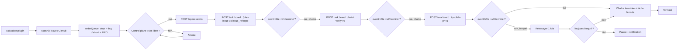

# openfox-automate

> 🇬🇧 [English version →](README.md)

Traitement autonome des issues GitHub pour [OpenFox](https://github.com/co-l/openfox).
Le plugin scanne les issues ouvertes des dépôts que vous surveillez, les classe de
manière intelligente (dépendances parent/enfant, bug vs. feature, FIFO), ouvre une
session OpenFox par issue, et exécute une chaîne de workflows configurable de bout
en bout (`plan-issue-v3` → `build-verify-v3` → `publish-pr-v1` par défaut).

| Licence | OpenFox peer | Statut |
|---------|--------------|--------|
| MIT     | `>=2.0.161`  | v0.1.0 |

## Pourquoi l’utiliser

- **Fini le copier-coller d’URL d’issue dans OpenFox** — choisissez les dépôts,
  étiquetez vos issues, le plugin s’occupe du reste.
- **Autonomie de bout en bout** — chaque session exécute une chaîne de workflows
  pour planifier, construire, vérifier et livrer sans intervention manuelle.
- **Gardez le contrôle** — pause, reprise, retraitement et inspection de chaque
  session depuis le panneau Issue Queue.
- **Zéro dépendance runtime** — `fetch` natif, pas de SDK.

## Comment ça marche



## Architecture du plugin

Le plugin s’exécute **dans le process** d’OpenFox et joint l’hôte via son **API
HTTP locale supportée**.

Un plugin n’a PAS accès aux internes de l’hôte : sur OpenFox 2.0.161,
`PluginContext` ne déclare que `id`, `version`, `runtime`, `logger`, `storage`,
`settings`, `notify` et `publish` — il n’y a ni `host` ni `openFoxInternals`. Le
plugin utilise donc la surface HTTP documentée de l’hôte, qui est aussi le seul
chemin où l’hôte résout un lancement de workflow :

```ts
// 1. Une session par issue.
POST http://127.0.0.1:10369/api/sessions
  { projectId, title }              → 201 { session: { id, workdir } }

// 2. Une tâche par étape de la chaîne, sur le tableau de tâches de l’hôte.
POST http://127.0.0.1:10369/api/projects/:projectId/tasks
  { prompt: '/plan-issue-v3 acme/widgets#7 acme/widgets' }
POST http://127.0.0.1:10369/api/projects/:projectId/tasks/:taskId/move
  { to: 'in_progress', sessionId }   → { task, sessionId }

// 3. La tâche est fermée à la fin de la chaîne, sinon l’hôte garde son slot.
POST http://127.0.0.1:10369/api/projects/:projectId/tasks/:taskId/move
  { to: 'done' }
```

Le prompt `/<workflow-id> <args…>` est la syntaxe de lancement **de l’hôte** :
l’hôte résout l’identifiant du workflow, mappe les arguments sur ses paramètres
**déclarés**, **par position**, et refuse le lancement si un paramètre requis
manque.

### Les paramètres sont ceux du workflow, pas ceux du plugin

L’hôte découpe le prompt sur chaque espace et mappe les jetons obtenus sur les
paramètres que le workflow déclare, triés par leur `position` déclarée. Deux
conséquences déterminent ce que le plugin envoie :

- **Aucun texte libre.** L’hôte SUPPRIME aussi le prompt quand il lance le
  workflow : le corps de l’issue et les commentaires ne sont donc jamais
  transportés. Le planificateur relit l’issue lui-même avec un `gh issue view`
  authentifié — seule la CIBLE voyage.
- **Seulement les paramètres déclarés.** Le plugin lit les déclarations dans
  `GET /api/workflows` et mappe ses valeurs dessus par nom. Si cette lecture
  échoue, le lancement est **refusé** plutôt que deviné.

Les workflows pilotés par le plugin déclarent :

| Workflow | Paramètres déclarés |
|----------|---------------------|
| `plan-issue-v3` | `issue_ref` (position 0, **requis**), `repo` (position 1) |
| `build-verify-v3` | `workdir` (position 0) |
| `publish-pr-v1` | `workdir` (position 0) |

`{{workdir}}` est résolu par l’hôte depuis la **session** : le plugin ne propose
donc un `workdir` que s’il connaît le vrai répertoire de travail.

### Vérification côté hôte

```bash
# Le statut LOCAL de l’hôte — aucun appel réseau, sûr à sonder :
curl -X POST http://localhost:10369/api/plugins/openfox-automate/rpc/hostStatus
# → { "baseUrl": "http://127.0.0.1:10369", "transport": "http", ... }

# Le contrôle COMPLET (interroge l’API GitHub) — pour un diagnostic explicite :
curl -X POST http://localhost:10369/api/plugins/openfox-automate/rpc/health
# → { "github": { ... }, "host": { ... }, "workflows": { ... }, ... }
```

## Pré-requis

- OpenFox `>=2.0.161` (API HTTP locale et runner de workflows)
- Node.js `>=24` (pour `fetch` natif)
- Un Personal Access Token GitHub avec les portées :
  - `repo` (lecture/écriture issues et PR sur les dépôts cibles)
  - `read:org` (si les dépôts sont dans une organisation)
- Trois workflows OpenFox disponibles par identifiant (défauts) :
  - `plan-issue-v3`
  - `build-verify-v3`
  - `publish-pr-v1`
- Un projet OpenFox par dépôt cible (le mapping relie dépôts et projets).

## Installation

1. Ouvrez OpenFox et allez dans **Settings → Plugins**.
2. Cliquez sur **Install from GitHub URL** et saisissez
   `https://github.com/theshwal/openfox-automate`.
3. Cliquez sur **Enable**.
4. Un nouveau bouton **Issue Queue** apparaît dans l’en-tête.
5. Ouvrez le panneau, remplissez le formulaire **Settings** (jeton + mappage des
   dépôts) et le plugin est prêt.

## Configuration

### Requis

| Clé | Rôle |
|-----|------|
| `github.token` | Votre PAT à granularité fine. |
| `repos.mapping` | Une ligne `owner/repo=projectId` par dépôt. |

### Connexion à l’hôte

L’hôte n’expose ni son port ni son jeton à un plugin : l’URL est donc fournie par
l’opérateur. Les défauts correspondent à ceux de l’hôte.

| Clé | Défaut | Rôle |
|-----|--------|------|
| `host.baseUrl` | `http://127.0.0.1:10369` en production, `http://127.0.0.1:10469` en développement | L’API HTTP locale de l’hôte. Seule une origine **loopback** est acceptée — une URL mal saisie est refusée avant toute requête, donc le jeton de session ne quitte jamais la machine. |
| `host.sessionToken` | vide | Le jeton de session de l’hôte. Nécessaire seulement si la stratégie d’authentification de l’hôte est `network` ET qu’un mot de passe est défini ; l’API loopback est ouverte sinon. |

### Optionnel (défauts fournis)

| Clé | Défaut | Rôle |
|-----|--------|------|
| `workflows.chain` | `plan-issue-v3` / `build-verify-v3` / `publish-pr-v1` | Identifiants de workflows exécutés séquentiellement par session. |
| `workflows.repoOverrides` | vide | `owner/repo=w1,w2,w3` surcharge la chaîne pour un dépôt. |
| `scan.refreshMinutes` | `30` | Intervalle d’auto-scan. |
| `scan.startupScan` | `false` | Scanner immédiatement à l’activation. Le scan ne fait que LIRE GitHub. |
| `scan.ignoreLabels` | `wontfix,duplicate,needs-discussion` | Issues avec un de ces labels ignorées. |
| `batch.maxConcurrency` | `5` | Plafond global de sessions simultanées (plafonné à 5). |
| `batch.maxConcurrencyPerRepo` | `5` | Plafond par dépôt (combiné via `min(global, perRepo)`). |
| `ordering.strategy` | `default` | `default` \| `priority-labels` \| `strict-deps`. |
| `ordering.dependencyPattern` | regex | Détecte `#N`, `depends on #N`, `blocked by #N` dans le corps des issues. |
| `dryRun` | `true` | Si vrai : scan et tri mais aucune session, aucune écriture GitHub, aucun workflow lancé. |
| `history.retentionCount` | `100` | Nombre max d’entrées terminées gardées dans l’historique. |
| `post.closeOnSuccess` | `false` | Fermer l’issue à la fin de la chaîne. |
| `post.assignOnSuccess` | `false` | M’assigner l’issue à la fin de la chaîne. |
| `post.commentTemplate` | vide | Modèle de commentaire optionnel (`publish-pr-v1` gère par défaut). |
| `post.reprocessResetsRetryCount` | `true` | Le retraitement remet le compteur à zéro. |
| `pr.monitorEnabled` | `true` | Surveiller les PR ouvertes (conflits / fusions). |
| `pr.urlRegex` | regex PR GitHub | Regex pour capturer les URL de PR dans la sortie de l’agent. |
| `budget.maxTokensPerIssue` | `0` | Budget de tokens par issue ; `0` = illimité. |
| `control.leaseMinutes` | `10` | Durée de détention d’une réservation avant reprise par le control plane. |

### Exemple `repos.mapping`

```
# Format : owner/repo=id-projet-openfox
theshwal/visipdp = proj-visipdp-abc123
theshwal/api-server = proj-api-def456
mon-org/private-tool = proj-private-ghi789
```

### Exemple `workflows.repoOverrides`

```
# Format : owner/repo=id-workflow1,id-workflow2,id-workflow3
theshwal/api-server = plan-issue-v3,build-verify-v3,publish-pr-v1
```

## Utilisation

Après installation + configuration, le plugin :

1. Scanne chaque dépôt mappé pour les issues ouvertes (à la demande, et toutes
   les `refreshMinutes`).
2. Détecte les dépendances entre issues et les trie
   (`default` : sans bloqueurs → bug > feature > docs → FIFO).
3. Ouvre une session OpenFox par issue en tête de file, en respectant
   `maxConcurrency` (global et par dépôt), et y exécute la chaîne de workflows.
4. Marque l’entrée de file `done` une fois la chaîne terminée avec succès.
5. Capture l’URL de PR ouverte et la surveille (conflits, fusions).

Ouvrez le panneau **Issue Queue** pour :

- Inspecter les onglets File active, Historique, Métriques.
- Filtrer la file par texte libre ou statut.
- Déclencher un scan, mettre en pause, annuler une session en cours, retraiter
  une entrée en échec.
- Lancer un contrôle de santé (jeton + dépôts + workflows + projets + mappage).

Le panneau affiche l’hôte joigné et le nombre de divergences entre le control
plane (l’autorité) et la file. Il interroge un statut **local**, donc le laisser
ouvert ne consomme pas le quota GitHub.

## Capabilities

| Capability | Utilisation |
|------------|------------|
| `tools` | `issue_queue_list`, `issue_queue_status` |
| `settings` | Formulaire de settings auto-rendu |
| `ui` | `issue-queue-panel`, action header |
| `rpc` | `automate.scanNow`, `automate.startIssue`, `automate.cancelIssue`, `automate.reprocess`, `automate.removeIssue`, `automate.addIssueRaw`, `automate.health`, `automate.hostStatus`, `automate.controlPlaneStatus`, `automate.controlPlaneSchedule`, `automate.getQueue`, `automate.getHistory`, `automate.getMetrics`, `automate.ping` |
| `hooks` | `workflow.execution.changed`, `task.completed`, `tool.completed`, `llm.completed` |
| `notifications` | Toasts : entrée ajoutée, chaîne terminée, retry, erreurs |

## Permissions

Le plugin s’exécute dans le même process qu’OpenFox et joint l’hôte via son
**API HTTP locale** sur l’interface loopback. Il n’importe jamais les internes de
l’hôte, et aucun mot de passe n’est requis.

L’accès GitHub utilise le PAT stocké dans `github.token`. Par défaut, le plugin
ne fait **aucune écriture** sur GitHub — l’interaction (commentaire, label, PR,
fermeture) est déléguée au workflow `publish-pr-v1`. Activez les toggles `post.*`
pour surcharger. Il n’existe **aucun chemin d’auto-merge** : le plugin ne fait
que réagir à une PR déjà fusionnée.

## Dépannage

| Symptôme | Cause probable / correctif |
|----------|----------------------------|
| **Le plugin n’apparaît pas dans l’onglet Plugins** | Vérifiez que l’URL `https://github.com/theshwal/openfox-automate` est accessible et qu’OpenFox a accès au réseau. |
| **Le panneau affiche `unreachable` pour l’hôte** | L’appel `automate.hostStatus` a échoué. Vérifiez que l’hôte tourne et que `host.baseUrl` pointe dessus. |
| **`host.transport: missing` au health check** | `host.baseUrl` est vide et le port par défaut de l’hôte n’est pas joignable. Définissez `host.baseUrl` explicitement. |
| **`workflows: not-found` au health check** | Un identifiant de `workflows.chain` n’existe pas. Vérifiez dans l’onglet **Workflows** d’OpenFox. |
| **`mapping: invalid` au health check** | Une ligne de `repos.mapping` est mal formée. Le panneau de health check affiche les numéros de ligne. |
| **Rien ne démarre, et le log dit que le lancement a été refusé** | Les paramètres déclarés du workflow n’ont pas pu être lus, ou un paramètre requis manque. Vérifiez `GET /api/workflows` sur l’hôte. |
| **La file grandit mais rien ne se lance** | Tous les slots sont occupés. Augmentez `batch.maxConcurrency` ou attendez la fin des chaînes en cours. |
| **Notifications « bloqué » répétées** | Un workflow n’atteint pas `$done`. Ouvrez la session, intervenez manuellement, cliquez sur **Re-process**. |
| **Avertissement rate-limit à chaque scan** | Réduisez la fréquence de scan (`scan.refreshMinutes`) ou utilisez un jeton avec des limites plus élevées. |

## Développement

```bash
# Installation des dépendances (les peer deps viennent de votre install OpenFox)
npm install

# Vérification de types
npm run typecheck

# Tests unitaires
npm test

# Tests e2e (fetch GitHub mocké)
npm run test:e2e

# Build de la sortie compilée (dist/) utilisée par le host plugin
npm run build
```

## Limitations / Problèmes connus

- Le plugin joint l’hôte par son API HTTP locale. L’hôte n’expose ni son port ni
  son jeton de session à un plugin : l’URL (et le jeton, quand la stratégie
  d’authentification de l’hôte est `network`) doivent être configurés.
- L’hôte ne réutilise qu’une session **sans messages** : chaque étape de la
  chaîne se déroule donc dans une **nouvelle** session. Le plugin suit la session
  que l’hôte rapporte, et la chaîne avance malgré tout.
- Le plugin tient son propre control plane durable, car un plugin ne peut pas
  accéder au tableau de tâches de l’hôte. Il duplique la DÉCISION de
  planification de l’hôte, pas son moteur d’exécution.
- La pagination au-delà de 100 issues par dépôt et par scan est implémentée via
  une boucle de pages ; les grands dépôts peuvent prendre plus longtemps à scanner.
- Le scan piloté par webhook est prévu pour la v2 (polling uniquement en v1).

## Licence

MIT.
