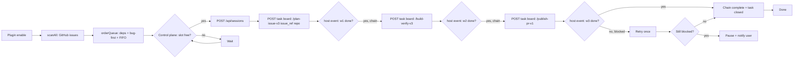

# openfox-automate

> 🇫🇷 [Version française →](README.fr.md)

Autonomous GitHub issue processing for [OpenFox](https://github.com/co-l/openfox). Scan
open issues on the repositories you care about, order them intelligently (parent/child
dependencies, bug vs. feature, FIFO), open one OpenFox session per issue, and run a
configurable chain of workflows end-to-end (`plan-issue-v3` → `build-verify-v3`
→ `publish-pr-v1` by default).

| License | OpenFox peer | Status |
|---------|--------------|--------|
| MIT     | `>=2.0.161`  | v0.1.0 |

## Why use it

- **Stop copy-pasting issue URLs into OpenFox** — pick the repositories, label your
  issues, and the plugin takes care of the rest.
- **End-to-end autonomy** — sessions run a chain of workflows so each issue is
  planned, built, verified, and delivered without manual handoff.
- **Stay in control** — pause, resume, re-process, and inspect every session from the
  Issue Queue panel.
- **Zero runtime dependencies** — native `fetch`, no SDKs.

## How it works



## Plugin architecture

The plugin runs **in-process** with the OpenFox host, and reaches the host through
the **supported local HTTP API**.

A plugin does NOT get the host's internals: on OpenFox 2.0.161 `PluginContext`
declares only `id`, `version`, `runtime`, `logger`, `storage`, `settings`, `notify`
and `publish` — there is no `host` and no `openFoxInternals`. The plugin therefore
uses the host's documented HTTP surface, which is also the only path where the host
resolves a workflow launch:

```ts
// 1. One session per issue.
POST http://127.0.0.1:10369/api/sessions
  { projectId, title }              → 201 { session: { id, workdir } }

// 2. One task per chain step, on the host's task board.
POST http://127.0.0.1:10369/api/projects/:projectId/tasks
  { prompt: '/plan-issue-v3 acme/widgets#7 acme/widgets' }
POST http://127.0.0.1:10369/api/projects/:projectId/tasks/:taskId/move
  { to: 'in_progress', sessionId }   → { task, sessionId }

// 3. The task is closed when the chain ends, so the host frees its slot.
POST http://127.0.0.1:10369/api/projects/:projectId/tasks/:taskId/move
  { to: 'done' }
```

The `/<workflow-id> <args…>` prompt is the host's OWN launch syntax: the host
resolves the workflow id, maps the arguments onto the workflow's **declared**
parameters **by position**, and refuses the launch when a required parameter is
missing.

### The parameters are the workflow's, not the plugin's

The host splits the prompt on every whitespace and maps the resulting tokens onto
the parameters the workflow declares, sorted by their declared `position`. Two
consequences shape what the plugin sends:

- **No free text.** The host also DROPS the prompt when it launches the workflow,
  so the issue body and the comments are never transported. The planner re-reads
  the issue itself with an authenticated `gh issue view`, so only the TARGET
  travels.
- **Only declared parameters.** The plugin reads the declarations from
  `GET /api/workflows` and maps its values onto them by name. When that read
  fails, the launch is **refused** rather than guessed.

The workflows the plugin drives declare:

| Workflow | Declared parameters |
|----------|---------------------|
| `plan-issue-v3` | `issue_ref` (position 0, **required**), `repo` (position 1) |
| `build-verify-v3` | `workdir` (position 0) |
| `publish-pr-v1` | `workdir` (position 0) |

`{{workdir}}` is resolved by the host from the **session**, so the plugin only
offers a `workdir` when it knows the real working directory.

### Host-side verification

```bash
# The LOCAL status of the host — no network call, safe to poll:
curl -X POST http://localhost:10369/api/plugins/openfox-automate/rpc/hostStatus
# → { "baseUrl": "http://127.0.0.1:10369", "transport": "http", ... }

# The FULL check (queries the GitHub API) — for an explicit diagnostic:
curl -X POST http://localhost:10369/api/plugins/openfox-automate/rpc/health
# → { "github": { ... }, "host": { ... }, "workflows": { ... }, ... }
```

## Requirements

- OpenFox `>=2.0.161` (the local HTTP API and the workflow runner)
- Node.js `>=24` (for native `fetch`)
- A GitHub Personal Access Token with scopes:
  - `repo` (read/write issues and pull requests on the target repositories)
  - `read:org` (if the repositories live in an organisation)
- Three OpenFox workflows available by id (defaults):
  - `plan-issue-v3`
  - `build-verify-v3`
  - `publish-pr-v1`
- One OpenFox project per target repository (the mapping ties repos to projects).

## Installation

1. Open OpenFox and go to **Settings → Plugins**.
2. Click **Install from GitHub URL** and enter
   `https://github.com/theshwal/openfox-automate`.
3. Click **Enable**.
4. A new header button **Issue Queue** appears.
5. Open the panel, fill in the **Settings** form (token + repo mapping), and you're
   ready.

## Configuration

### Required

| Key | Purpose |
|-----|---------|
| `github.token` | Your fine-grained PAT. |
| `repos.mapping` | One `owner/repo=projectId` per line. |

### Host connection

The host does not expose its port or its token to a plugin, so the URL is
operator-supplied. The defaults match the host's own defaults.

| Key | Default | Purpose |
|-----|---------|---------|
| `host.baseUrl` | `http://127.0.0.1:10369` in production, `http://127.0.0.1:10469` in development | The host's local HTTP API. Only a **loopback** origin is accepted — a mistyped URL is refused before any request, so the session token never leaves the machine. |
| `host.sessionToken` | empty | The host's session token. Only needed when the host's authentication strategy is `network` AND a password is set; the loopback API is open otherwise. |

### Optional (defaults provided)

| Key | Default | Purpose |
|-----|---------|---------|
| `workflows.chain` | `plan-issue-v3` / `build-verify-v3` / `publish-pr-v1` | Ordered workflow IDs run sequentially per session. |
| `workflows.repoOverrides` | empty | `owner/repo=w1,w2,w3` overrides the chain for one repo. |
| `scan.refreshMinutes` | `30` | Auto-scan interval. |
| `scan.startupScan` | `false` | Scan immediately on plugin enable. The scan only READS GitHub. |
| `scan.ignoreLabels` | `wontfix,duplicate,needs-discussion` | Issues with any of these labels are skipped. |
| `batch.maxConcurrency` | `5` | Global ceiling on simultaneous sessions (capped at 5). |
| `batch.maxConcurrencyPerRepo` | `5` | Per-repo ceiling (combined with global via `min(global, perRepo)`). |
| `ordering.strategy` | `default` | `default` \| `priority-labels` \| `strict-deps`. |
| `ordering.dependencyPattern` | regex | Detects `#N`, `depends on #N`, `blocked by #N` in issue bodies. |
| `dryRun` | `true` | When true, scan and order run but no session is created, no GitHub write happens, no workflow is launched. |
| `history.retentionCount` | `100` | Max terminated entries kept in history. |
| `post.closeOnSuccess` | `false` | Close the issue on chain completion. |
| `post.assignOnSuccess` | `false` | Assign the issue to you on completion. |
| `post.commentTemplate` | empty | Optional comment template (`publish-pr-v1` handles comments by default). |
| `post.reprocessResetsRetryCount` | `true` | Re-process resets the retry counter. |
| `pr.monitorEnabled` | `true` | Poll opened PRs for conflicts / merges. |
| `pr.urlRegex` | GitHub PR URL regex | Pattern used to capture PR URLs from agent output. |
| `budget.maxTokensPerIssue` | `0` | Token budget per issue; `0` means unlimited. |
| `control.leaseMinutes` | `10` | How long a reservation is held before the control plane reclaims it. |

### Example `repos.mapping`

```
# Format: owner/repo=openfox-project-id
theshwal/visipdp = proj-visipdp-abc123
theshwal/api-server = proj-api-def456
mon-org/private-tool = proj-private-ghi789
```

### Example `workflows.repoOverrides`

```
# Format: owner/repo=workflowId1,workflowId2,workflowId3
theshwal/api-server = plan-issue-v3,build-verify-v3,publish-pr-v1
```

## Usage

After install + configuration, the plugin:

1. Scans every mapped repository for open issues (on demand, and every
   `refreshMinutes`).
2. Detects dependencies between issues and orders them
   (`default`: no blockers → bug > feature > docs → FIFO).
3. Opens one OpenFox session per top-of-queue issue, respecting `maxConcurrency`
   (global and per repo), and runs the configured workflow chain on it.
4. Marks the queue entry `done` once the chain completes successfully.
5. Captures any opened PR URL and monitors it for conflicts and merges.

Open the **Issue Queue** panel to:

- Inspect the active queue, history, and metrics tabs.
- Filter the queue by free-text or status.
- Trigger a scan, pause auto-scan, cancel a running session, re-process a failed entry.
- Run a health check (token + repos + workflows + projects + mapping).

The panel shows the host it talks to and the number of divergences between the
control plane (the authority) and the queue. It polls a **local** status, so
leaving it open does not spend the GitHub quota.

## Capabilities

| Capability | Used for |
|------------|----------|
| `tools` | `issue_queue_list`, `issue_queue_status` |
| `settings` | Auto-rendered settings form |
| `ui` | `issue-queue-panel`, header action |
| `rpc` | `automate.scanNow`, `automate.startIssue`, `automate.cancelIssue`, `automate.reprocess`, `automate.removeIssue`, `automate.addIssueRaw`, `automate.health`, `automate.hostStatus`, `automate.controlPlaneStatus`, `automate.controlPlaneSchedule`, `automate.getQueue`, `automate.getHistory`, `automate.getMetrics`, `automate.ping` |
| `hooks` | `workflow.execution.changed`, `task.completed`, `tool.completed`, `llm.completed` |
| `notifications` | Toasts on entry added, chain done, retries, errors |

## Permissions

The plugin runs in-process with the rest of OpenFox and reaches the host through
its **local HTTP API** on the loopback interface. It never imports the host's
internals, and no password is required.

GitHub access uses the PAT stored in `github.token`. By default the plugin makes
**no write calls** to GitHub — interaction (comment, label, PR, close) is delegated
to the `publish-pr-v1` workflow. Toggle the `post.*` settings to override. There
is **no auto-merge path**: the plugin only reacts to a PR that is already merged.

## Troubleshooting

| Symptom | Likely cause / fix |
|---------|--------------------|
| **Plugin does not appear in the Plugins tab** | Check the URL `https://github.com/theshwal/openfox-automate` resolves and that OpenFox has network access. |
| **The panel shows `unreachable` for the host** | The `automate.hostStatus` RPC failed. Check that the host is running and that `host.baseUrl` points at it. |
| **Health check shows `host.transport: missing`** | `host.baseUrl` is empty and the host's default port is not reachable. Set `host.baseUrl` explicitly. |
| **Health check shows `workflows: not-found`** | One or more workflow IDs in `workflows.chain` are not installed. Verify in OpenFox **Workflows** tab. |
| **Health check shows `mapping: invalid`** | A `repos.mapping` line is malformed. Run the panel health check to see line numbers. |
| **Nothing starts, and the log says the launch was refused** | The workflow's declared parameters could not be read, or a required one is missing. Check `GET /api/workflows` on the host. |
| **Queue grows but nothing spawns** | All slots are busy. Increase `batch.maxConcurrency` or wait for current chains to finish. |
| **Repeated "blocked" notifications** | The workflow cannot reach `$done`. Open the session, intervene manually, then click **Re-process**. |
| **Rate limit warning on every scan** | Decrease scan frequency (`scan.refreshMinutes`) or use a token with higher rate limits. |

## Development

```bash
# Install deps (peer deps come from your OpenFox install)
npm install

# Type-check
npm run typecheck

# Run unit tests
npm test

# Run e2e (GitHub fetch is mocked)
npm run test:e2e

# Build the compiled output (dist/) used by the plugin host
npm run build
```

## Limitations / Known issues

- The plugin reaches the host through its local HTTP API. The host does not
  expose its port or its session token to a plugin, so the URL (and the token,
  when the host's authentication strategy is `network`) must be configured.
- The host only reuses a session that has **no messages**, so each step of a
  chain runs in a **new** session. The plugin follows the session the host
  reports, so the chain still advances.
- The plugin keeps its own durable control plane because a plugin cannot access
  the host's task board. It duplicates the host's scheduling DECISION, not its
  execution engine.
- Pagination beyond 100 issues per repository per scan is implemented via a
  follow-up page loop; large repositories may take longer to scan.
- Webhook-driven scans are planned for v2 (polling only in v1).

## License

MIT.
